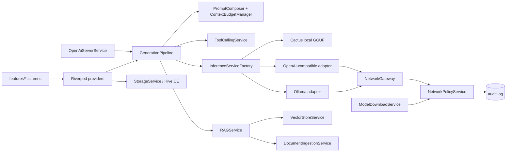

# Development guide

Everything you need to run, test and change PocketLLM Lite. For project rules
(theme tokens, shared widgets, versioning, changelog) read
[`Agents.MD`](Agents.MD) and [`CONTRIBUTING.md`](CONTRIBUTING.md) first.

## Prerequisites

| Tool | Version | Notes |
| --- | --- | --- |
| Flutter | stable 3.41+ (Dart 3.6+ SDK constraint) | CI uses `subosito/flutter-action` stable |
| Android SDK | API 24 minimum, target 36 | Only needed for `flutter run` / APK builds |
| Node.js | 20 or newer (CI uses 22) | Only for `webapp/` |
| Ollama | optional | Only when working on the Ollama adapter |

## First run (Android app)

```bash
flutter pub get
flutter analyze            # must report no issues
flutter test               # unit, service and widget tests, ~25 s
flutter run                # emulator or device
```

Generated Hive adapters are committed (`*.g.dart`, `hive_registrar.g.dart`).
Re-generate only if you change an annotated model:
`dart run build_runner build --delete-conflicting-outputs`.

`flutter pub get` on Windows rewrites `macos/Flutter/GeneratedPluginRegistrant.swift`
and `windows/flutter/generated_plugins.cmake`. Do not commit those unless you
changed dependencies.

## Before opening a pull request

```bash
dart format .
flutter analyze
flutter test
```

CI runs `dart format --set-exit-if-changed`, `flutter analyze` and
`flutter test`, plus a web job (`tsc`, `next build`, `npm audit` for critical).

## Architecture at a glance



Rules that keep the privacy promise true:

1. All app-managed HTTP goes through `NetworkGateway` or the policy interceptor
   in `ModelDownloadService`. Do not construct `http.Client`, `Dio` or call
   `launchUrl` elsewhere. `test/regressions/release_truth_test.dart` enforces the
   `launchUrl` part.
2. Every new outbound destination needs a `ConnectionPurpose`, an entry in
   `assets/network_policy.json`, and a policy test.
3. New tools are registered only in `lib/services/tool_calling_service.dart`.
   Anything with a side effect sets `requiresConfirmation: true` and a scope.
4. Never return success for work that did not happen. No canned model output.

## Where things live

| You want to change | Look in |
| --- | --- |
| Streaming, tool loop, cancellation | `lib/services/generation_pipeline.dart` |
| Network rules, Strict Offline | `lib/services/network_policy_service.dart`, `network_gateway.dart` |
| Local model download / verify | `lib/services/model_download_service.dart`, `model_storage_service.dart` |
| Document import and chunking | `lib/services/document_ingestion_service.dart` |
| Retrieval modes | `lib/services/hybrid_retrieval_service.dart`, `vector_store_service.dart` |
| Embedded API server | `lib/services/openai_server_service.dart` |
| Theme and shared widgets | `lib/core/theme/`, `lib/core/widgets/` |
| Translations | `lib/l10n/` (`en`, `es`, `zh`, `ja`, `ko`, `hi`) |

## Testing notes

- Service tests inject fakes for inference and storage. Look at
  `test/services/openai_server_service_test.dart` for a self-contained example
  that starts a real loopback server on port 0.
- Write the failing test first for bug fixes. Several recent fixes were
  reproduced this way (see `docs/QA_TEST_REPORT.md`).
- `integration_test/core_flows_test.dart` needs a device or emulator:
  `flutter test integration_test`.
- Do not assert on performance numbers in unit tests; record measurements in a
  report instead.

## Web Edition (`webapp/`)

```bash
cd webapp
npm ci
npm run dev              # http://localhost:3000
npx tsc --noEmit
npx next build
npx eslint src           # currently has known react-hooks findings
```

`webapp/AGENTS.md` warns that this Next.js version differs from older releases;
read `node_modules/next/dist/docs/` before changing framework-level code.
Fonts are self-hosted through `next/font`; do not add third-party font or
script tags. Run `node scripts/growth_report.mjs` for public repository metrics.

## Release checklist (maintainers)

1. Bump `pubspec.yaml` following the patch/minor rule in `Agents.MD`.
2. Update `CHANGELOG.md`, `RELEASE_NOTES.md` and the README version badge
   (`release_truth_test` fails if they disagree).
3. `flutter analyze && flutter test`.
4. `flutter build apk --split-per-abi --release`, record SHA-256 sums.
5. Attach the APKs and `SHA256SUMS.txt` to the GitHub release. State plainly if
   the build is debug-signed.
